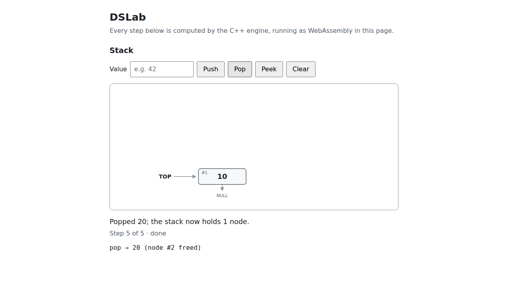

# DSLab: Interactive Data Structure Simulator

A college data-structures project. A C++17 engine implements every structure and
algorithm; it is compiled to WebAssembly and drawn in the browser with React and SVG.
Every step you see is a frame recorded by the C++ code while it runs. There is no
JavaScript copy of any algorithm and no backend.

**Status:** milestone 7. All seven structures (stack, queue, singly linked list, ordinary
binary tree, binary search tree, AVL tree and red-black tree) run in C++ and are taught
in one workspace: play, pause, step and scrub through every operation with its
pseudocode line, node properties and operation counters beside it; pan and zoom; batch,
seeded random and preset examples (AVL rotations, red-black fix-up cases); keyboard
shortcuts. Every operation can be undone and redone, and each structure can be exported
to a JSON file and imported again, checked in C++ first (see [docs/plan.md](docs/plan.md)).



## Prerequisites

Tested on Ubuntu 24.04 under WSL2 on ARM64 (aarch64). Any Linux or macOS machine with
the same tools should work.

| Tool | Version | Why |
| --- | --- | --- |
| g++ (or clang++) | C++17 support; g++ 13.3 tested | native build and tests |
| CMake | 3.20 or newer; 3.28 tested | builds both native and WebAssembly |
| Ninja | 1.11 tested | CMake generator |
| Python 3 | any recent | needed by emsdk |
| Node.js | 22.12 or newer; 24.22 tested (via nvm) | Vite, React, TypeScript |
| Emscripten (emsdk) | **exactly 6.0.13**, pinned in [docs/toolchain.md](docs/toolchain.md) | compiles C++ to WebAssembly |

On Ubuntu, `scripts/setup-system.sh` installs the apt packages, nvm with Node 24 and
Playwright's Chromium. Run it as yourself; it asks for `sudo` only where needed:

```bash
bash scripts/setup-system.sh
```

Install emsdk once (any folder works; `~/tools/emsdk` is the one used here):

```bash
git clone https://github.com/emscripten-core/emsdk.git ~/tools/emsdk
```

```bash
cd ~/tools/emsdk && ./emsdk install 6.0.13 && ./emsdk activate 6.0.13
```

Then tell the build where emsdk is, in every new shell or in `~/.bashrc`:

```bash
export EMSDK=$HOME/tools/emsdk
```

`npm run build:wasm` uses `$EMSDK` if it is set, otherwise an `em++` already on your
PATH (for example after `source ~/tools/emsdk/emsdk_env.sh`). If it finds neither, it
stops and explains what to set. It also refuses any Emscripten version other than the
pinned one.

To check the whole toolchain at once:

```bash
bash scripts/check-env.sh
```

## Commands

Run these from the repository root. Install the web dependencies once, and again after
`package.json` changes:

```bash
npm install
```

| Command | What it does | Output |
| --- | --- | --- |
| `npm run test:cpp` | Native CMake build and the C++ tests (doctest) | `build/native/` |
| `npm run test:cpp:asan` | The same tests under AddressSanitizer + UBSan, built with `-O1` (about 25 minutes) | `build/asan/` |
| `npm run test:e2e` | Production build, the native command runner, then the Playwright suite (`web/e2e/`) against `npm run preview` in Playwright's bundled Chromium (about 5 minutes) | `test-results/` |
| `npm run build:wasm` | Compiles the engine with Emscripten and copies it next to the web sources | `build/wasm/`, `web/src/generated/` |
| `npm run dev` | `build:wasm`, then the Vite dev server at http://localhost:5173/ | — |
| `npm run build` | `build:wasm`, a TypeScript check, then the production build | `dist/` |
| `npm run preview` | Serves `dist/` locally at http://localhost:4173/ | — |

A typical first run:

```bash
npm run test:cpp
```

```bash
npm run dev
```

Open http://localhost:5173/, type a number and press **Push**.

The production build uses relative URLs, so `dist/` works at a site root and under a
sub-path such as GitHub Pages' `https://<user>.github.io/dslab/`. Upload the whole
folder, including `dist/assets/`.

## If something goes wrong

- **`build:wasm failed: Emscripten was not found`**: set `EMSDK` (see Prerequisites).
- **`em++ is version X, but docs/toolchain.md pins 6.0.13`**: run
  `emsdk install 6.0.13 && emsdk activate 6.0.13` in your emsdk folder.
- **The page says "The C++ engine could not be loaded"**: it names the file, the exact
  URL it tried and what went wrong (for example HTTP 404). In development run
  `npm run build:wasm`; for a deployment rebuild and upload all of `dist/`.

## How it is built

- [docs/architecture.md](docs/architecture.md): components, and the path from a click
  to C++ and back to SVG.
- [docs/operation-contract.md](docs/operation-contract.md): operations, error codes, the
  JSON request/response schema and the frame schema.
- [docs/plan.md](docs/plan.md): milestones and what each one delivers.
