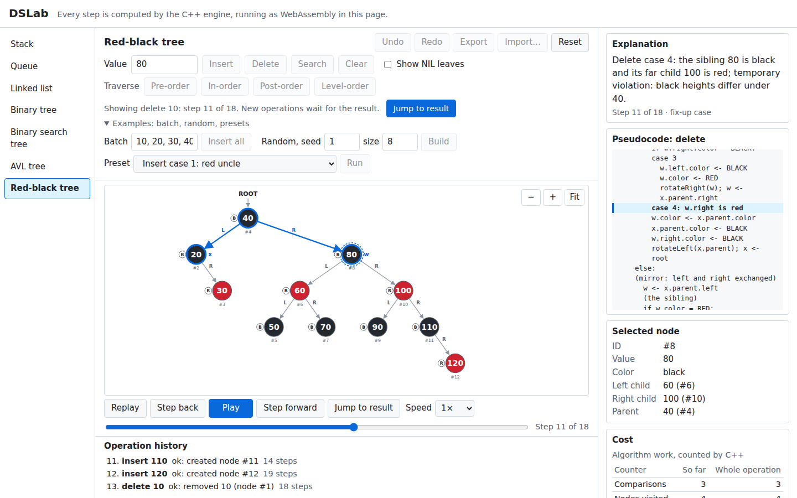
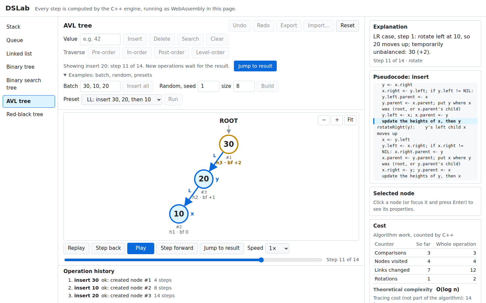
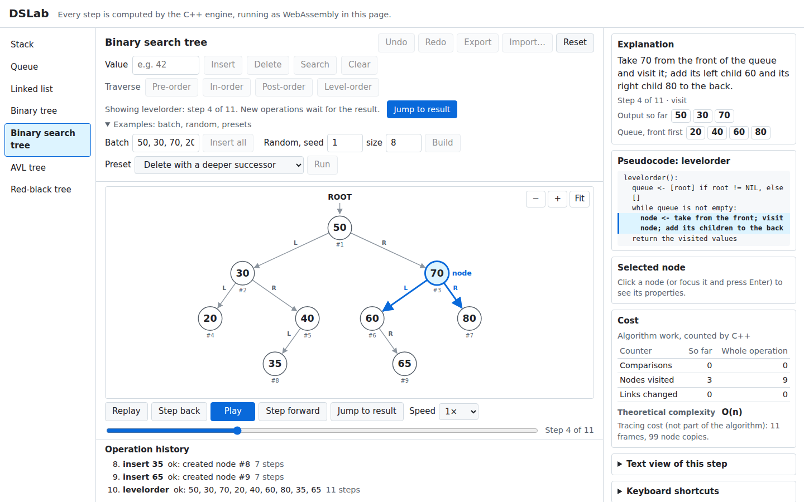
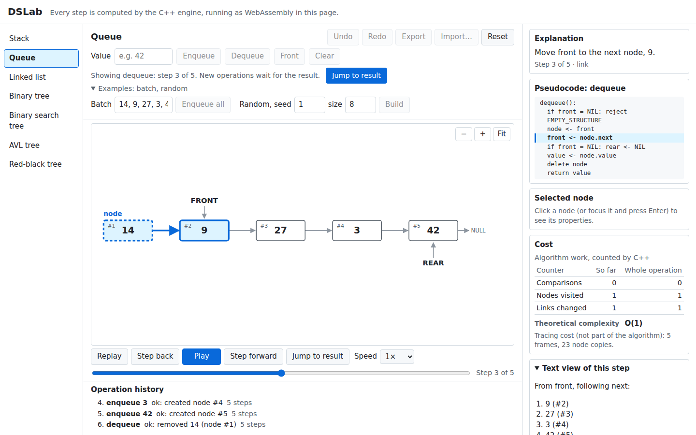
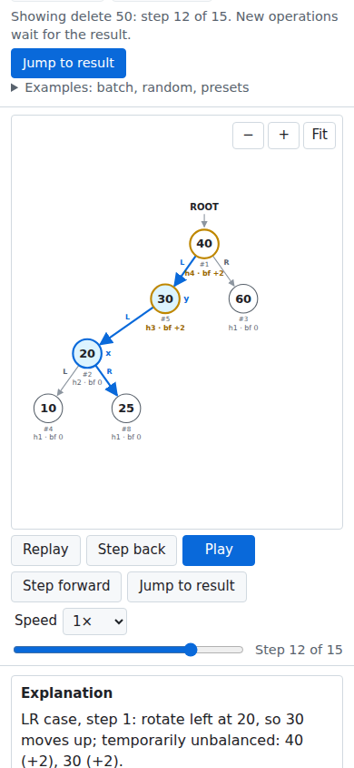

#  DSLab: Interactive Data Structure Simulator

[](https://github.com/its-harsh-here/dslab/actions/workflows/deploy.yml)

**Live site: https://its-harsh-here.github.io/dslab/**

DSLab teaches seven data structures by showing every step of every operation. The
structures and algorithms are written in C++17. The same C++ code is compiled natively
for the tests and to WebAssembly for the browser, where React draws each step with SVG.
Every frame you see was recorded **inside the running C++ algorithm**. There is no
JavaScript copy of any algorithm and no server: the whole simulator runs in your browser
tab.



*A red-black tree paused at step 11 of 18 of `delete 10`, in delete fix-up case 4. The
pointers `x` and `w` are drawn on the tree. Beside it: the explanation (which marks the
temporary violation), the highlighted pseudocode line, the selected node #8 and the work
counted so far.*

## Contents

- [Highlights](#highlights)
- [The seven structures](#the-seven-structures)
- [Watching an operation](#watching-an-operation)
- [Reading the drawing](#reading-the-drawing)
- [Playback and keyboard](#playback-and-keyboard)
- [Examples: batch, random and presets](#examples-batch-random-and-presets)
- [Undo, redo, export, import and reset](#undo-redo-export-import-and-reset)
- [Errors and validation](#errors-and-validation)
- [Phone, dark mode and accessibility](#phone-dark-mode-and-accessibility)
- [More screenshots](#more-screenshots)
- [How it works](#how-it-works)
- [How correctness is checked](#how-correctness-is-checked)
- [Setup](#setup) · [Build and run](#build-and-run) · [Tests](#tests) ·
  [Deployment](#deployment-github-pages) · [Known limitations](#known-limitations) ·
  [Troubleshooting](#troubleshooting) · [Project layout](#project-layout) ·
  [Documentation](#documentation)

## Highlights

- **Seven structures**, each implemented by hand in C++ with linked nodes: stack, queue,
  singly linked list, ordinary binary tree, binary search tree (BST), AVL tree and
  red-black tree. No `std::stack`, `std::queue`, `std::list`, `std::set` or `std::map`.
- **Every step is a real frame.** A frame holds the whole structure, the highlighted
  nodes and edges, the algorithm's pointer variables, an event type, a one-sentence
  explanation written in C++, and the ID of the pseudocode line being executed.
- **Play, pause, step, scrub and replay** any operation at four speeds. The matching
  pseudocode line is highlighted, and the explanation is read out to screen readers.
- **Stable node IDs.** Every node has an ID (`#3`) that never changes, through rotations,
  successor moves and undo. You select nodes by ID, never by value.
- **Algorithm cost is kept apart from tracing cost.** C++ counts comparisons, nodes
  visited, links changed, rotations and recolors. The page shows them growing step by
  step next to the operation's Big-O, and separately how many frames and node copies
  the animation needed.
- **Teaching examples:** batch input, seeded random structures, and presets for every AVL
  rotation case (LL, RR, LR, RL), all seven red-black fix-up cases, a BST two-child
  delete and a degenerate BST.
- **Undo and redo** (50 steps per structure, exact, including node IDs), and **export
  and import** of any structure as a JSON file, checked completely in C++ before
  anything changes.
- **Pan, zoom and fit**, a **text view** of every step, an **operation history**, full
  **keyboard control**, **reduced motion**, **dark mode** and a **phone layout**.
- **Thoroughly tested:**
  - 106 native C++ test cases, with an independent invariant checker after every
    operation;
  - the same suite under AddressSanitizer and UBSan;
  - 27 browser tests that compare the screen with C++'s frames;
  - 1,298 requests answered identically by the native and the WebAssembly builds.

## The seven structures

Choose a structure in the list on the left, or open the site with `#stack`, `#queue`,
`#list`, `#binaryTree`, `#bst`, `#avl` or `#redBlack` at the end of the URL. Each
structure keeps its own state, history and undo list while you look at another one.
Values are 32-bit signed integers, and each structure holds at most 200 nodes.

### Stack (linked nodes, `top` pointer)

| Operation | Button | Time | What you see |
| --- | --- | --- | --- |
| push(value) | **Push** | O(1) | a new node is created and linked to the old top, then `top` moves to it |
| pop() | **Pop** | O(1) | `top` moves down, then the old top node is freed |
| peek() | **Peek** | O(1) | the top value is read; nothing changes |
| clear() | **Clear** | O(n) | every node is freed, one at a time |

### Queue (linked nodes, `front` and `rear` pointers)

| Operation | Button | Time | What you see |
| --- | --- | --- | --- |
| enqueue(value) | **Enqueue** | O(1) | the new node is linked after `rear`, and `rear` moves to it |
| dequeue() | **Dequeue** | O(1) | `front` moves on and the old front is freed; `rear` becomes NIL when the queue empties |
| front() | **Front** | O(1) | the front value is read |
| clear() | **Clear** | O(n) | every node is freed |

### Singly linked list (`head` pointer only)

| Operation | Button | Time | What you see |
| --- | --- | --- | --- |
| insertAt(index, value) | **Insert at index** | O(i) | `prev` walks i − 1 links, then the new node is linked in (index 0 changes `head`) |
| search(value) | **Search value** | O(n) | `curr` walks from `head` until it finds the value or reaches NIL |
| deleteNode(id) | **Delete selected** (click a node first) | O(n) | `prev` walks to the predecessor, which then bypasses the node |
| reverse() | **Reverse** | O(n) | `prev`, `curr` and `next` flip one link per step, then `head` moves |
| clear() | **Clear** | O(n) | every node is freed |

### Ordinary binary tree (`root`, parent links; you choose every position)

| Operation | Button | Time | What you see |
| --- | --- | --- | --- |
| addRoot(value) | **Add root** | O(1) | only when the tree is empty |
| addChild(parent, side, value) | **Add left child** / **Add right child** (click the parent first) | O(1) | the new node is linked under the selected node |
| deleteSubtree(id) | **Delete selected subtree** | O(k) | the subtree's k nodes are freed in post-order, children first |
| preorder, inorder, postorder | **Pre-order**, **In-order**, **Post-order** | O(n) | the traversal moves node by node, and the output list grows |
| levelorder | **Level-order** | O(n) | the queue's contents are shown at every step |
| clear() | **Clear** | O(n) | every node is freed |

Duplicates are allowed here, as in the linear structures.

### Binary search tree (CLRS)

| Operation | Button | Time | What you see |
| --- | --- | --- | --- |
| insert(value) | **Insert** | O(h) | compare and move left or right down to a NIL child, then link the new node |
| delete(value) | **Delete** | O(h) | search, then the leaf, one-child or two-child case (see below) |
| search(value) | **Search** | O(h) | one path from the root, until the value is found or NIL is reached |
| four traversals | **Traverse** row | O(n) | as for the binary tree |
| clear() | **Clear** | O(n) | every node is freed |

For a node with two children, the in-order **successor node** is detached and moved
into place with `transplant`. Its value is never copied, so the node keeps its ID.

h is the height: O(log n) for random input, but n − 1 for sorted input. Duplicates are
rejected.

### AVL tree (heights stored, parent links)

Course conventions: height(NIL) = 0, a leaf has height 1, and balance = height(left) −
height(right). Every node shows `h` and `bf`; a balance of ±2 is marked in amber.

| Operation | Button | Time | What you see |
| --- | --- | --- | --- |
| insert(value) | **Insert** | O(log n) | the BST insert, then a walk up to the root updating heights; at an imbalance, the case (LL, LR, RR or RL) is named and the single or double rotation is shown |
| delete(value) | **Delete** | O(log n) | the BST delete, then the same walk; several rotations can happen on the way up |
| search(value) | **Search** | O(log n) | one path from the root |
| traversals, clear | | O(n) | as for the binary tree |

### Red-black tree (CLRS, one black NIL sentinel)

Red and black nodes carry **R** and **B** badges. Tick **Show NIL leaves** to draw the
black NIL leaves as well.

| Operation | Button | Time | What you see |
| --- | --- | --- | --- |
| insert(value) | **Insert** | O(log n) | the BST insert of a red node, then `insertFixup` |
| delete(value) | **Delete** | O(log n) | the CLRS delete with the successor node, then `deleteFixup` |
| search(value) | **Search** | O(log n) | one path from the root |
| traversals, clear | | O(n) | as for the binary tree |

The fix-up cases, each named in the explanation as it happens (with mirror versions
for the other side):

| Fix-up | Case | What happens |
| --- | --- | --- |
| `insertFixup` | 1: red uncle | recolor, then move up the tree |
| | 2: black uncle, inner child | rotate, turning it into case 3 |
| | 3: black uncle, outer child | recolor and rotate |
| `deleteFixup` (removes the extra black) | 1: red sibling | recolor and rotate, then continue with case 2, 3 or 4 |
| | 2: black sibling with two black children | recolor the sibling, then move the extra black up |
| | 3: black sibling, near child red | rotate, turning it into case 4 |
| | 4: black sibling, far child red | recolor and rotate; the fix-up ends |

Frames in which a property is broken for a moment, during a fix-up, say so: "temporary
violation: black heights differ under 40." The full design is in
[docs/red-black.md](docs/red-black.md); the AVL design is in [docs/avl.md](docs/avl.md).

## Watching an operation

The workspace has six parts:

| Part | What it shows |
| --- | --- |
| **Structure list** (left) | the seven structures; the current one is marked |
| **Operations** (top) | the structure's buttons and value boxes; Undo, Redo, Export, Import and Reset; the status line; the Examples box |
| **Drawing** (middle) | the structure at the current step, with pan, zoom and Fit |
| **Player** (below the drawing) | Replay, Step back, Play/Pause, Step forward, Jump to result, Speed and the step slider |
| **Step details** (right) | Explanation, Pseudocode, Selected node, Cost, Text view and Keyboard shortcuts |
| **Operation history** (bottom) | every request sent for this structure, its result and its number of steps |

The right-hand panels show:

- **Explanation**:
  - the frame's sentence from C++, such as "25 < 30, so move to the left child, 20.";
  - the step and event, such as "Step 4 of 11 · visit";
  - for traversals, the output so far, and for level order, the queue (front first);
  - the operation's result or error, once playback reaches it.
- **Pseudocode**: the operation's full listing from the C++ catalog, with the current
  line highlighted and kept in view. It includes the helper procedures the operation
  calls: AVL `fixUp`, `rebalance` and the rotations, and the red-black fix-ups with their
  mirror cases.
- **Selected node**: click a node, or focus it and press Enter. It shows the node as it
  is **at the step on screen**:
  - always its ID and value;
  - in linear structures, its next node and its position;
  - in trees, its left child, right child and parent;
  - in the AVL tree, its height and balance; in the red-black tree, its color.

  If the node does not exist at that step, the panel says so.
- **Cost**:
  - the C++ counters at this step ("so far") and for the "whole operation": comparisons,
    nodes visited, links changed, rotations (AVL and red-black) and recolors
    (red-black);
  - the operation's theoretical complexity;
  - the tracing cost (frames and node copies), labelled as not part of the algorithm.
- **Text view of this step**: the structure as text. Linear structures show a chain such
  as "From front, following next: 9 (#2), 27 (#3)…"; trees show a nested list with
  left and right children, colors or heights. Nodes that are not linked at this step are
  listed separately.
- **Keyboard shortcuts**: the list in [Playback and keyboard](#playback-and-keyboard).

The **status line** says "Ready" with a legend for the structure. While an operation is
on screen it says, for example, "Playing insert 20: step 3 of 14. 2 more queued. New
operations wait for the result.", next to a **Jump to result** button. The operation
buttons stay disabled until then, so a fast double click never sends two requests.

The **operation history** lists each request ("insert 25", "insertAt [2] 7", "undo")
with its outcome ("ok: created node #4", the result values or the error code) and how
many steps it recorded. Rejected requests are listed and marked too.

## Reading the drawing

| Mark | Meaning |
| --- | --- |
| `#5` under a node | the node's ID: stable, never reused, independent of the value |
| **TOP**, **FRONT** / **REAR**, **HEAD** / **TAIL**, **ROOT** | the structure's entry pointers |
| `[2]` under a list node | its index from `head` |
| `NULL` after the last node | the end of the chain |
| **L** / **R** on tree edges | left or right child link |
| blue node or edge | touched by this step |
| blue label next to a node | one of the algorithm's pointer variables at this step: `curr`, `prev`, `next`, `parent`, `node`, `x`, `y`, `w`… |
| dashed node | not reachable from the entry pointer at this step (see below) |
| `h3 · bf +1` (AVL) | height and balance; amber when the balance is ±2 |
| red or black fill with an **R** or **B** badge | the red-black node's color |
| small `NIL` boxes (optional) | the red-black tree's NIL leaves |
| ring around a node | the selected node |

A node is dashed when it was just created, is being unlinked, or is in the part of a
list that is not reversed yet. It still exists, because the C++ node pool owns it.

Nodes slide between steps. Because they are identified by ID, a rotation looks like the
same nodes moving to new places, and edges follow the moving nodes.

**View controls:**
- drag the empty background to pan;
- use the mouse wheel to zoom at the pointer, or the **−** and **+** buttons;
- **Fit** returns to the automatic view, which keeps the whole operation in frame so
  nothing jumps while it plays.

## Playback and keyboard

| Control | Button | Key |
| --- | --- | --- |
| Play / pause | **Play** / **Pause** | `Space` or `K` |
| One step back / forward | **Step back** / **Step forward** | `←` / `→` |
| First step | the slider | `Home` |
| Jump to the result (also finishes a waiting batch) | **Jump to result** | `End` |
| Replay from the start | **Replay** | `R` |
| Slower / faster (0.5×, 1×, 2×, 4×; 1× = 600 ms per step) | **Speed** | `[` / `]` |
| Any step | the slider ("Step 4 of 13") | — |
| Zoom in / out / fit | **+** / **−** / **Fit** | `+` / `-` / `0` |
| Pan | drag | `Shift` + arrows |
| Undo / redo the last operation | **Undo** / **Redo** | `Ctrl+Z` / `Ctrl+Y` (or `Ctrl+Shift+Z`) |
| Leave a text box | | `Esc` |

Keys work when the focus is not in a text box. Pausing always lands on one exact frame.
Stepping backwards is instant, because every frame's layout is computed once.

## Examples: batch, random and presets

Open **Examples** above the drawing:

- **Batch**: type values separated by commas (`10, 20, 30`) and press the batch button:
  **Push all**, **Enqueue all**, **Append all** (list) or **Insert all** (BST, AVL,
  red-black).
  - The values are sent **one request at a time, in order**. Each one plays before the
    next is sent, and each appears in the history.
  - If C++ rejects a value (a duplicate, or a number outside 32 bits), it is logged with
    its error and the batch continues.
  - If any item is not a whole number, nothing is sent.
- **Random**: a seed and a size (1 to 30) build a random structure from values 1 to 99
  (all different in the search trees).
  - The same seed always gives the same structure, so a class can share an example by
    its seed.
  - In the ordinary binary tree, each value goes under a random node that has a free
    side.
  - The random values are only input: every insert still runs in C++.
- **Presets** set up a small structure without animation, then play the operation that
  shows the case:

| Structure | Presets |
| --- | --- |
| BST | Delete with a deeper successor (50, 30, 70, 20, 40, 60, 80, 65, then delete 50); Sorted inserts (a degenerate tree: 10, 20, 30, 40, 50) |
| AVL | LL: insert 30, 20, then 10 · RR: insert 10, 20, then 30 · LR: insert 30, 10, then 20 · RL: insert 10, 30, then 20 |
| Red-black | Insert case 1: red uncle · Insert case 2: inner child · Insert case 3: outer child · Delete case 1: red sibling · Delete case 2: black sibling, black children · Delete case 3: near child red · Delete case 4: far child red |

## Undo, redo, export, import and reset

- **Undo** and **Redo** (the buttons, or `Ctrl+Z` and `Ctrl+Y`) restore the structure
  **exactly**:
  - node IDs and the next-ID counter included: undo an insert, insert again, and the new
    node gets the same ID;
  - they are played as steps themselves ("Undo insert 25 on the AVL tree.");
  - each structure keeps up to 50 steps, undo and redo together;
  - a new operation after an undo clears the redo list;
  - the buttons show how many steps are available.
- **Export** saves the structure as `dslab-<structure>.json`. It is a versioned document
  (`"format": "dslab-structure"`, `"formatVersion": 1`) with every node's ID, value,
  links, heights or colors, and the ID counter.
- **Import…** loads such a file (up to 1 MiB). C++ checks everything before changing
  anything:
  - valid JSON, the format and version, the right structure, and exactly the right
    fields with the right types;
  - unique IDs, and links that point at real nodes;
  - one chain or one tree, with consistent parent links;
  - the BST order, every AVL height and balance, and all five red-black properties;
  - the ID counter.

  A file that breaks any rule changes nothing, and the error names the first broken rule
  ("Node 4 has balance 2, but an AVL tree allows only −1, 0 or +1."). A successful
  import can be undone.
- **Reset** stops any playback, clears the structure (which can be undone) and empties
  the history list.

## Errors and validation

The page only checks that a box holds a whole number. Every other rule is checked in
C++, and a rejected operation changes nothing: no node, no link and no ID is used up.
Errors are played as steps ending in a "reject" frame, with a sentence such as "Cannot
pop: the stack is empty."

| Code | When |
| --- | --- |
| `EMPTY_STRUCTURE` | pop, peek, dequeue or front on an empty structure |
| `CAPACITY_EXCEEDED` | creating a 201st node |
| `INDEX_OUT_OF_RANGE` | `insertAt` with an index outside 0…n |
| `NODE_NOT_FOUND` | the selected node no longer exists |
| `ROOT_EXISTS`, `CHILD_EXISTS` | adding a root to a non-empty tree, or a child where one exists |
| `DUPLICATE_VALUE` | inserting a value already in a BST, AVL or red-black tree |
| `VALUE_NOT_FOUND` | deleting a value that is not in the tree |
| `NOTHING_TO_UNDO`, `NOTHING_TO_REDO` | undo or redo with an empty list |
| `IMPORT_INVALID` | an import file that breaks any rule above |
| `VALUE_OUT_OF_RANGE` | a number outside the 32-bit range |
| `ID_EXHAUSTED` | no node IDs left (only reachable by importing a file with huge IDs) |

A search that finds nothing is not an error: it reports "not found". The full list,
including the protocol errors, is in
[docs/operation-contract.md](docs/operation-contract.md).

## Phone, dark mode and accessibility

- **Phone and narrow windows** (below 900 px): the parts stack vertically, the Examples
  box starts closed, and nothing scrolls sideways (the tests check this at 390 px).
- **Dark mode** follows your system setting.
- **Reduced motion:** with the system's reduced-motion setting on, nodes do not slide,
  but operations still play step by step.
- **Screen readers and keyboard:**
  - every control has a label;
  - the explanation is an `aria-live` region, so each step's sentence is read out;
  - nodes are focusable buttons named "Node #3 holding 20" (with the color in the
    red-black tree);
  - the pseudocode marks the current line;
  - everything can be done from the keyboard, with a visible focus outline.
- **A tab icon:** a small binary tree, shown in the browser tab and as the home-screen
  icon on phones.
- If the WebAssembly engine cannot load, the page names the file, the exact URL and the
  cause (for example HTTP 404), and says how to fix it.

## More screenshots

| | |
| --- | --- |
|  |  |
| **AVL insert 20 (LR case)**, step 11 of 14: the left rotation at 10. 30 is still marked +2 in amber; 1 of the 2 rotations is done. | **BST level-order**, step 4 of 11: the output so far is 50, 30, 70, and the queue holds 20, 40, 60, 80. |
|  |  |
| **Queue dequeue**, step 3 of 5: `front` has moved to 9. The old front, 14, is no longer linked: it is drawn dashed and listed under "Not linked in this step" in the text view. | **Phone layout** (390 px): AVL delete 50, LR case, the first of the two rotations. |

## How it works

```
 Browser tab (no server)
 ┌─────────────────────────────────────┐   request JSON    ┌──────────────────────────────────────┐
 │ React + TypeScript (web/src)        │ ────────────────▶ │ C++17 engine compiled to WebAssembly │
 │  forms collect input                │                   │  Engine.handle(json)  (Embind)       │
 │  player: timing, steps, batches     │                   │  protocol: parse + validate          │
 │  layout: x, y for each node ID      │                   │  structure: runs the real algorithm, │
 │  SVG drawing, panels                │ ◀──────────────── │   recording a frame at every step    │
 └─────────────────────────────────────┘  response JSON    └──────────────────────────────────────┘
                                         result + final snapshot + frames + counters
```

1. A click builds a JSON request, for example
   `{"structure": "bst", "operation": "insert", "args": {"value": 25}}`.
2. `Engine.handle`, the only C++ function JavaScript can call, parses and validates the
   request and calls `Bst::insert`.
3. The real algorithm runs. At each pseudocode step it records a frame: a copy of the
   whole structure, highlights, pointers, explanation and step ID.
4. The response carries the result (or a typed error), the final structure, the frames,
   the counters and the undo and redo counts.
5. TypeScript lays out every frame once and plays the frames back. It never changes the
   structure or decides an outcome.

**Memory:** each structure's `NodePool` owns its nodes through `std::unique_ptr`. Every
link (`next`, `left`, `right`, `parent`, `top`, `root`…) is a non-owning raw pointer, as
in the textbook. Frames and history hold copies with IDs instead of pointers, so they
can never dangle. Memory is bounded: 200 nodes, 512 frames per operation, 50 undo steps.

More detail is in [docs/architecture.md](docs/architecture.md) (with a table of which
files hold C++ algorithms and which hold browser presentation),
[docs/memory.md](docs/memory.md) and [docs/trace-playback.md](docs/trace-playback.md).

**Technology:**
- engine: C++17 (g++ or clang), CMake and Ninja, Emscripten 6.0.13 with Embind;
- vendored libraries: nlohmann/json and doctest;
- web: React 19, TypeScript 7 and Vite 8;
- testing and hosting: Playwright, GitHub Actions and GitHub Pages.

## How correctness is checked

| Check | What it proves |
| --- | --- |
| 106 native C++ test cases (doctest), `npm run test:cpp` | every operation and every error code, plus the per-operation checks below |
| Seeded random sequences | for example 10,000 queue, 5,000 list, 3,000 binary-tree and 5,000 BST operations, compared with standard-library oracles (`std::vector`, `std::deque`, `std::set`, `std::map`, allowed in tests) |
| Golden files and import fixtures | exact JSON responses, and valid and invalid export files for every rule |
| `npm run test:cpp:asan` | the whole suite under AddressSanitizer and UndefinedBehaviorSanitizer: no use-after-free, leak or undefined behaviour |
| 27 Playwright browser tests, `npm run test:e2e` | on the production build, every step on screen matches C++'s frame, for all seven structures; the user interactions listed below; any console error fails a test |
| Native versus WebAssembly | 1,298 requests (every operation, invalid input, imports, undo/redo, 200-node trees) get identical answers from the native build and from the WebAssembly build the site uses |
| GitHub Actions | on every push: the native tests, the build and the browser smoke tests; the site is deployed only if they pass |

After **every** operation in every C++ test, the tests check:
- the structure with an independent invariant checker: chain shape, tree shape, parent
  links, BST order, AVL heights and balances, and the five red-black properties;
- the frame rules: the first frame is `begin`, the last is `done` or `reject`, every step
  ID is in the pseudocode catalog, and a rejected operation changes nothing;
- that the response matches the engine's real state.

The browser tests compare everything on screen with the frame: nodes, values, IDs,
colors, heights, edges, highlights, pointers, explanation, pseudocode line and output.
They also cover pause, rapid clicking, scrubbing, the keyboard, batches, random
examples, switching structure, undo and redo, export and import, reduced motion, pan
and zoom, and the phone layout.

## Setup

Tested on Ubuntu 24.04 under WSL2 on ARM64 (aarch64), and on GitHub's `ubuntu-latest`
(x64) in CI. Any Linux or macOS machine with the same tools should work.

| Tool | Version | Why |
| --- | --- | --- |
| g++ (or clang++) | C++17 support; g++ 13.3 tested | native build and tests |
| CMake | 3.20 or newer; 3.28 tested | builds both native and WebAssembly |
| Ninja | 1.11 tested | CMake generator |
| Python 3, git | any recent | needed by emsdk |
| Node.js | 22.12 or newer; 24 tested (via nvm) | Vite, React, TypeScript, Playwright |
| Emscripten (emsdk) | **exactly the version in [`.emsdk-version`](.emsdk-version)** (6.0.13) | compiles C++ to WebAssembly |

On Ubuntu, `scripts/setup-system.sh` installs the apt packages, nvm with Node 24 and
Playwright's Chromium. Run it as yourself; it asks for `sudo` only where needed:

```bash
bash scripts/setup-system.sh
```

Install emsdk once (any folder works; `~/tools/emsdk` is the one used here):

```bash
git clone https://github.com/emscripten-core/emsdk.git ~/tools/emsdk
```

Get the code:

```bash
git clone https://github.com/its-harsh-here/dslab.git
```

```bash
cd dslab
```

From the repository root, install and activate the pinned Emscripten version. Both
commands read it from `.emsdk-version`, the same file the build script and CI read:

```bash
~/tools/emsdk/emsdk install "$(cat .emsdk-version)"
```

```bash
~/tools/emsdk/emsdk activate "$(cat .emsdk-version)"
```

Tell the build where emsdk is, in every new shell or in `~/.bashrc`:

```bash
export EMSDK=$HOME/tools/emsdk
```

Install the web dependencies at the exact versions in `package-lock.json`:

```bash
npm ci
```

Install Playwright's bundled Chromium for the browser tests (not Google Chrome, which
does not exist for Linux ARM64):

```bash
npx playwright install --no-shell chromium
```

To check the whole toolchain at once:

```bash
bash scripts/check-env.sh
```

`npm run build:wasm` finds Emscripten through `$EMSDK` if it is set, or otherwise
through an `em++` already on your PATH (for example after
`source ~/tools/emsdk/emsdk_env.sh`). If it finds neither, it stops and explains what to
set. It refuses any Emscripten version other than the one in `.emsdk-version`.

## Build and run

| Command | What it does | Output |
| --- | --- | --- |
| `npm run build:wasm` | Compiles the engine with Emscripten and copies it next to the web sources | `build/wasm/`, `web/src/generated/` |
| `npm run dev` | `build:wasm`, then the Vite dev server at http://localhost:5173/dslab/ | — |
| `npm run build` | `build:wasm`, a TypeScript check, then the production build | `dist/` |
| `npm run preview` | Serves `dist/` at http://localhost:4173/dslab/, exactly as GitHub Pages will | — |

```bash
npm run dev
```

Then open http://localhost:5173/dslab/. The site lives under `/dslab/` everywhere
(`base` in `vite.config.ts`), so local runs use the same URLs as the deployed site.

## Tests

| Command | What it runs | Time here |
| --- | --- | --- |
| `npm run test:cpp` | Native CMake build and the C++ tests (doctest) | about 35 s |
| `npm run test:cpp:asan` | The same tests under AddressSanitizer and UBSan, built with `-O1` | about 25 min |
| `npm run test:e2e` | Production build, the native command runner, then the whole Playwright suite (`web/e2e/`) against `npm run preview` in bundled Chromium, including the native-versus-Wasm comparison | about 2.5 min |
| `npm run test:e2e:smoke` | Only the tests tagged `@smoke` (what CI runs before deploying), against the existing `dist/`; run `npm run build` first | about 20 s |

Run them in this order on a fresh clone:

```bash
npm run test:cpp
```

```bash
npm run test:cpp:asan
```

```bash
npm run test:e2e
```

## Deployment (GitHub Pages)

`.github/workflows/deploy.yml` runs on every push to `main`, and from the Actions tab
(**Run workflow**). On `ubuntu-latest` it:

1. installs the Emscripten version in `.emsdk-version`, and Node 24;
2. runs `npm ci`, `npm run test:cpp` and `npm run build`;
3. installs Playwright's Chromium and runs `npm run test:e2e:smoke` against
   `npm run preview`;
4. only if all of that passed, publishes `dist/` with the official GitHub Pages actions
   (`configure-pages`, `upload-pages-artifact`, `deploy-pages`).

GitHub settings to change, once:

1. **Create the repository as public and name it exactly `dslab`.** The name is the URL
   path: `https://its-harsh-here.github.io/dslab/` must match `base: '/dslab/'` in
   `vite.config.ts`, which `playwright.config.ts` also uses. With a free GitHub account,
   Pages works only for public repositories.
2. Push `main` to it.
3. **Settings → Pages → Build and deployment → Source: GitHub Actions.** (Not "Deploy
   from a branch"; there is no `gh-pages` branch.)
4. **Settings → Actions → General → Actions permissions:** allow actions created by
   GitHub. The default, "Allow all actions and reusable workflows", is fine. The
   workflow asks for its own token permissions (`contents: read`, `pages: write`,
   `id-token: write`), so "Workflow permissions" can stay at the default, read-only.
5. **Settings → Environments → github-pages** is created automatically on the first
   deployment and lets only `main` deploy. Leave it as it is.
6. Open the **Actions** tab, choose **Test and deploy** and press **Run workflow** (or
   push to `main`). When it finishes, the `deploy` job shows the site's URL.

To use a different repository name, change `base` in `vite.config.ts`, and `baseURL`
and the server `url` in `playwright.config.ts`, to `/<name>/`.

## Known limitations

- **Size and values:** at most 200 nodes per structure, values are 32-bit signed
  integers, and node IDs are never reused. Large trees get small on screen; use zoom
  and pan.
- **Duplicates** are rejected in the BST, AVL and red-black trees (they are allowed in
  the linear structures and the ordinary binary tree).
- **Nothing is saved between visits.** All state lives in the page, and reloading starts
  empty. Use Export to keep a structure.
- **Undo history** is 50 steps per structure, undo and redo together. It covers only
  operations, not the playback position or the page's operation history (which keeps
  the last 100 entries).
- **List reverse drawing:** while a reverse is in progress, nodes keep their old places,
  so the flipped backward arrows and the `NULL` label of the first node can overlap the
  next node. The text view shows the links exactly.
- **Large responses:** a traversal of a 200-node tree records 402 frames, about 6 MB of
  JSON. It works, but the time from click to first frame on slow devices has not been
  measured.
- **One operation at a time:** a new operation waits until the one on screen reaches its
  result, and batches run one request after another.
- **The ordinary binary tree** has no batch insert, because positions are chosen by
  clicking a parent. Random examples pick a random free child slot instead.
- **Browsers:** the build targets Chrome and Edge 111+, Firefox 114+ and Safari 16.4+,
  but the automated tests run only in Playwright's Chromium.
- **CI** runs the native tests and the browser smoke tests on every push. The sanitizer
  suite (about 25 minutes) and the full browser suite are run locally.
- **Unexpected C++ exceptions** (none are known) are reported as `INTERNAL_ERROR`, but
  the engine does not yet roll the structure back to its state before the operation.
- **No formal accessibility audit** has been done, although every control has a label,
  the explanation is announced, keyboard control is complete and reduced motion is
  respected.
- Explanations are in English only.

## Troubleshooting

- **`build:wasm failed: Emscripten was not found`**: set `EMSDK` (see Setup).
- **`em++ is version X, but .emsdk-version pins Y`**: from the repository root, run
  `~/tools/emsdk/emsdk install "$(cat .emsdk-version)"` and
  `~/tools/emsdk/emsdk activate "$(cat .emsdk-version)"`.
- **The page says "The C++ engine could not be loaded"**: it names the file, the exact
  URL it tried and what went wrong (for example HTTP 404). In development, run
  `npm run build:wasm`; for a deployment, rebuild and upload all of `dist/`.

## Project layout

```
dslab/
├── engine/
│   ├── include/dslab/   headers: the seven structures, NodePool, Trace, Frame, Snapshot,
│   │                    History, Validate, Catalog, Engine, TreeTraversal, Limits…
│   ├── src/             the C++ algorithms (Stack.cpp … RedBlackTree.cpp), Engine, History,
│   │   └── json/        Validate, Catalog; json/Protocol.cpp: the only JSON code
│   ├── bindings/        wasm_bindings.cpp: the Embind class `Engine`
│   ├── tools/           dslab_cli.cpp: native command runner (tests)
│   ├── tests/           doctest suites, invariant checkers, golden files, import fixtures
│   └── third_party/     nlohmann/json and doctest (vendored, pinned)
├── web/
│   ├── index.html, public/ (tab icon)
│   ├── src/             App, ui/ (workspace, panels, player bar), panels/ (one per
│   │                    structure), playback/ (player), layout/, render/ (SVG), engine/
│   │                    (loads the .wasm, sends JSON)
│   └── e2e/             Playwright tests
├── scripts/             build-wasm.sh, check-env.sh, setup-system.sh, make-parity-commands.py
├── docs/                design documents (below) and screenshots
├── .github/workflows/   deploy.yml: tests, build, smoke tests, GitHub Pages
├── .emsdk-version       the pinned Emscripten version
└── CMakeLists.txt, CMakePresets.json, package.json, vite.config.ts, playwright.config.ts
```

## Documentation

| Document | Contents |
| --- | --- |
| [docs/architecture.md](docs/architecture.md) | Components, which files hold C++ algorithms and which hold browser presentation, the path from a click to C++ and back to SVG, builds, CI |
| [docs/operation-contract.md](docs/operation-contract.md) | Every operation and error code, the JSON request/response and frame schemas, limits, decisions |
| [docs/complexity.md](docs/complexity.md) | Time complexity of every operation, with tracing and rendering cost listed separately and measured |
| [docs/memory.md](docs/memory.md) | Node ownership and memory management |
| [docs/trace-playback.md](docs/trace-playback.md) | Frame format, playback, undo/redo, export/import |
| [docs/avl.md](docs/avl.md), [docs/red-black.md](docs/red-black.md) | Design and pseudocode of the two balanced trees |
| [docs/demo-script.md](docs/demo-script.md) | A five-minute demo |
| [docs/viva-questions.md](docs/viva-questions.md) | 30 viva questions with model answers |
| [docs/plan.md](docs/plan.md), [docs/toolchain.md](docs/toolchain.md) | Milestones and pinned tool versions |
